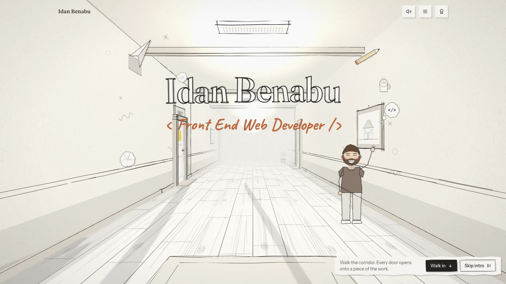
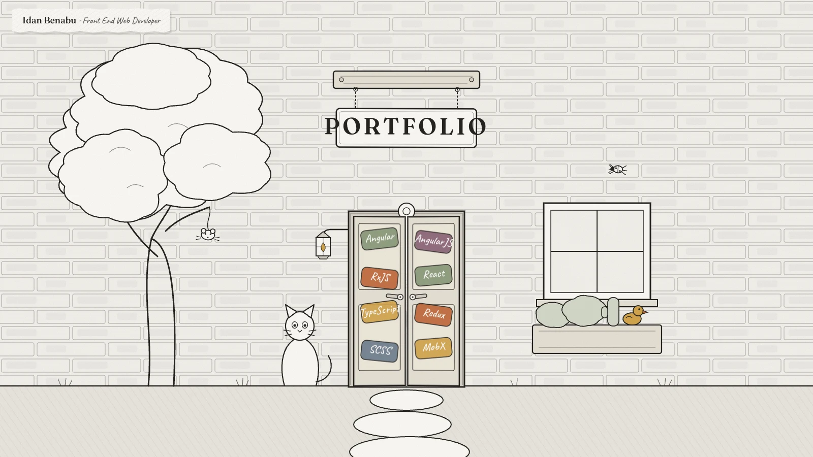
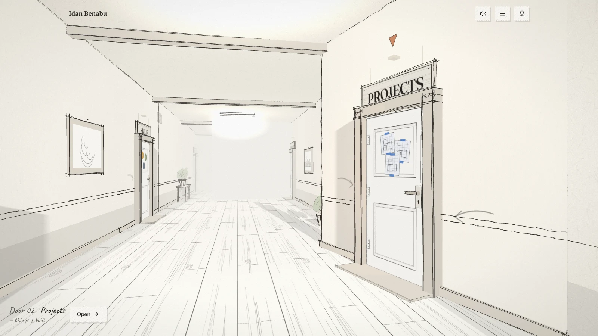
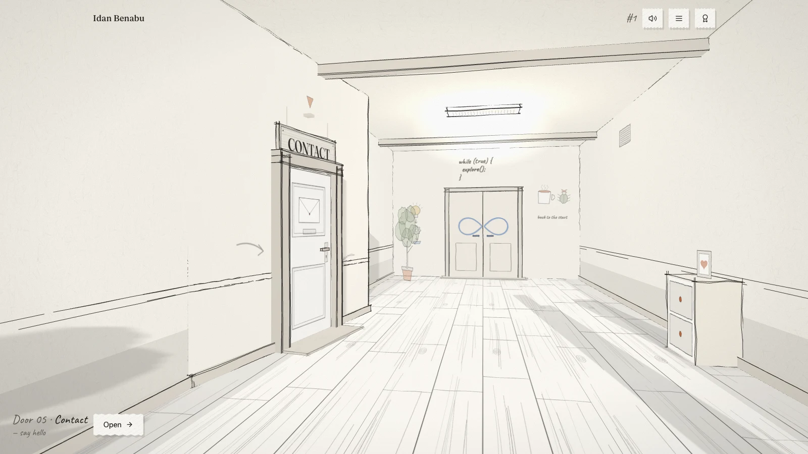
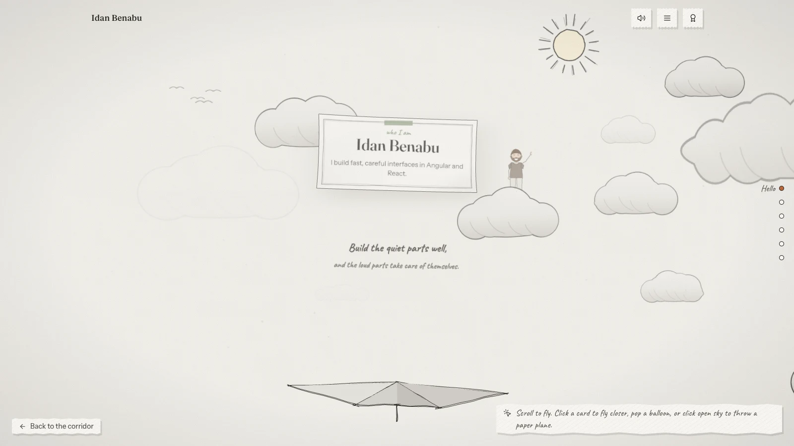
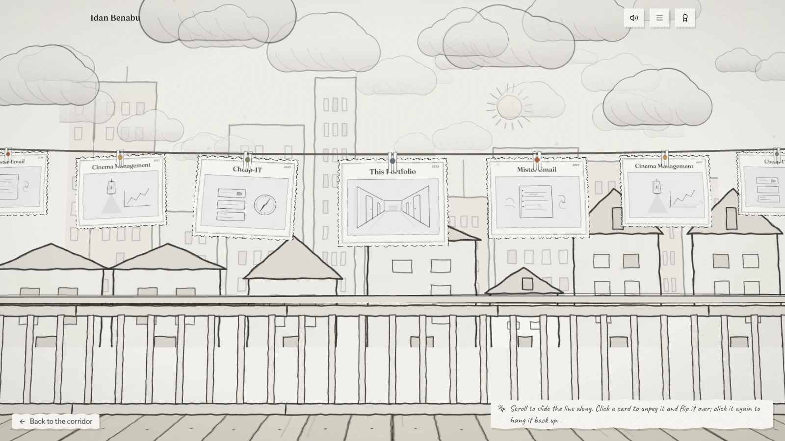
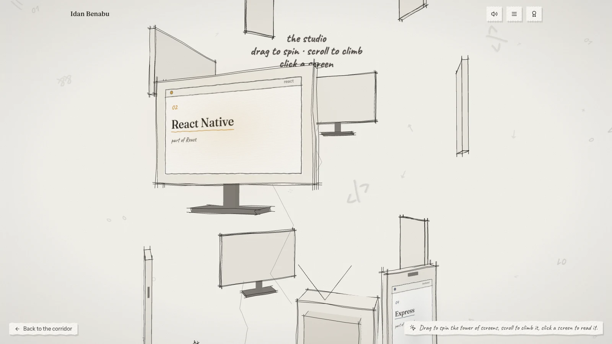
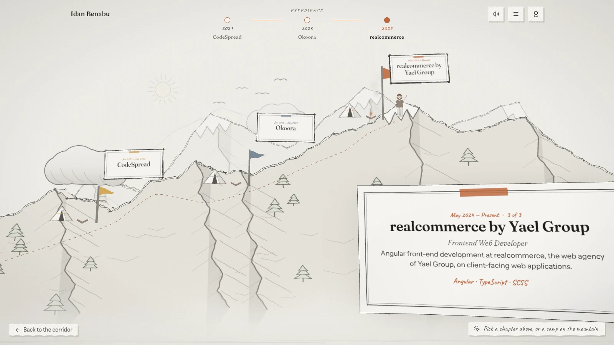
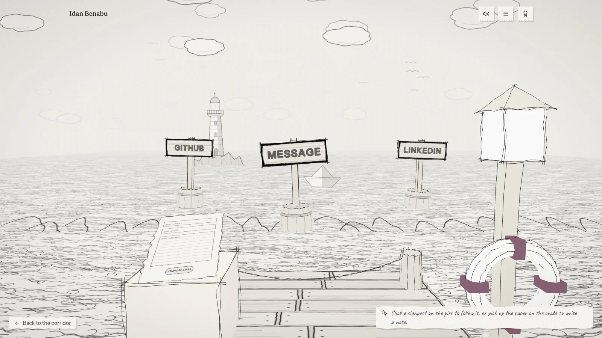

<div align="center">

# Illustrated Corridor

**An interactive 3D developer portfolio you walk through, drawn in pencil on white paper.**

[](https://react.dev)
[](https://www.typescriptlang.org)
[](https://vite.dev)
[](https://threejs.org)
[](https://gsap.com)
[](https://tailwindcss.com)



</div>

You arrive on the street outside, click the front door, and walk down a pencil-lined corridor.
Each side door opens onto a section (About, Projects, Skills, Experience, Contact). The double
door at the far end is marked with an infinity sign: walk through it and you are back at the
start.

Everything in the scene is procedural. There are no downloaded models or textures: paper
grain, pencil outlines, door plaques, framed sketches and almost every sound are generated at
runtime from an offscreen canvas, jittered line geometry and the Web Audio API. The one
recorded asset is the door creak, [Open Door Stock SFX](https://pixabay.com/sound-effects/open-door-stock-sfx-454246/)
by DRAGON-STUDIO, used under the Pixabay Content License.

## Contents

- [The tour](#the-tour)
- [Features](#features)
- [Getting started](#getting-started)
- [Make it yours](#make-it-yours)
- [How it works](#how-it-works)
- [Accessibility](#accessibility)
- [Licence](#licence)

## The tour

### 1. The street



A fresh visit starts behind a two-sided sheet of paper that counts up and tears open, then outside in front of a sketched brick facade. The sign sways on its chains, the cat's eyes follow the pointer, a mouse dangles from the tree, a doodle peeks out of the window, the rubber duck in the planter offers debugging advice and there is a bug to squash. Hovering the front door paints it and its stickers in; clicking (or pressing Enter) presses the handles, swings the leaves open in perspective and flies you through the opening, with the real corridor already visible behind it. Deep links such as `#/projects` skip the street.

### 2. The corridor



The page never scrolls. Wheel, touch drag and the arrow / page keys move a virtual distance counter, and the camera eases toward it. Mouse position adds a subtle look-around. Touch devices skip the parallax.

The walls fold in a sawtooth so every door faces you as you approach, with a bobbing "▼" marker and a halo that fade in within a few metres. Hovering cracks the leaf, turns the handle, creaks, and brush-paints the door's colour over the pencil drawing. Clicking a door (or a door on the map) walks the camera beside it, swings it open and carries you straight through the doorway into the room, with nothing covering the screen (the torn-paper wipe is kept only for jumping directly from one room to another); Escape, the back button or "Back to the corridor" backs you out the same way. Along the hallway hang four big frames you can hover to paint and click to lift in front of you, plus grates, a side table, a cabinet with a standing photo, plants and drawn ceiling lamps.

### 3. The loop



The far wall has a double door painted with an infinity sign and captioned `while (true) { explore(); }`. It opens as you approach, and the corridor simply repeats: the distance counter keeps growing, the world is drawn modulo one lap, and the first few metres past the door are built twice so nothing pops. A small `#n` lap counter appears in the header.

### 4. The rooms

Behind every door is a small 3D set that fills the screen. There is no text column over the
3D rooms; the text layout appears only in the no-WebGL fallback.

<table>
  <tr>
    <td width="50%" valign="top">
      
      <b>The sky (About).</b> Fly a paper plane with momentum through streamed clouds past
      milestones: name and avatar, a quote, journey islands, principles, tech balloons you can
      pop, and a loop marker. A flight map on the right jumps between them.
    </td>
    <td width="50%" valign="top">
      
      <b>The gallery (Projects).</b> A sagging clothesline carries an endless, scrollable run
      of project cards over a city skyline. Hovering a card brush-reveals its colour; clicking
      unpegs and flips it to show the details and a link.
    </td>
  </tr>
  <tr>
    <td width="50%" valign="top">
      
      <b>The studio (Skills).</b> An endlessly falling tower of TVs, monitors and phones. Drag
      to spin it, scroll to speed the fall, click a screen to turn it to face you and open a
      card with a typed description.
    </td>
    <td width="50%" valign="top">
      
      <b>The journey (Experience).</b> A paper-cut mountain with one camp per role. Pick a
      camp and a map pin walks the trail while that chapter unfolds.
    </td>
  </tr>
  <tr>
    <td width="50%" valign="top">
      
      <b>The pier (Contact).</b> Signposts on bobbing barrels for every way to get in touch,
      and a sheet of paper on a crate you pick up to write a note. It mirrors the form, then
      folds and sails off when sent.
    </td>
    <td width="50%" valign="top"></td>
  </tr>
</table>

## Features

| | |
| --- | --- |
| **Deep links** | Hash-based (`#/about`, `#/projects/<id>`), so every section is directly linkable and the browser's Back/Forward buttons work. |
| **Map** | The hamburger button drops down a torn-paper plan of the corridor with every door, the loop door and a pin where you stand; hovering a door paints its room in on the map and moves the pin there, and the same door cracks open in the hallway. |
| **Achievements** | Eight badges for exploring (open the door, walk, enter a room, inspect a project, throw a paper plane, spin the studio, say hello, walk through the loop). They are listed under the trophy button; progress is kept in `localStorage`. |
| **Sound** | Everything but one effect is synthesised with the Web Audio API: walking into a door plays a recorded door opening (the only audio file), the loop door swings and thuds, paper tears for the wipe, and each place has a quiet ambient bed (air in the corridor, wind in the sky, the sea off the pier, mains hum in the studio) that crossfades with the route. Nothing plays until the first click; the speaker button opens a panel with music and effects sliders and a mute toggle, and the choice is remembered. |
| **Quality tiers** | Phones get a lower pixel ratio, no shadows, fewer details and lights. Users who prefer reduced motion get instant transitions and no parallax. |
| **Fallbacks** | No WebGL → illustrated SVG corridor with the same links. A crash in the scene is caught by an error boundary and swaps in the same fallback. |

## Getting started

Requires Node 20+.

```bash
npm install
npm run dev        # http://localhost:5173
```

| Script                 | What it does                              |
| ---------------------- | ----------------------------------------- |
| `npm run dev`          | Vite dev server                           |
| `npm run build`        | Type-check and produce a production build |
| `npm run preview`      | Serve the production build locally        |
| `npm run typecheck`    | `tsc -b` only                             |
| `npm run lint`         | ESLint                                    |
| `npm run format`       | Prettier (write)                          |
| `npm run format:check` | Prettier (check)                          |

There is no test runner; verification is `npm run typecheck` and `npm run lint`.

## Make it yours

All content lives in `src/data/` and is plain TypeScript:

| File                     | Contents                                                                                     |
| ------------------------ | -------------------------------------------------------------------------------------------- |
| `siteConfig.ts`          | Name, title, headline, email, social links, form endpoint, the door definitions, loop door   |
| `about.ts`               | Summary, experience paragraph, interests, philosophy, current focus                          |
| `projects.ts`            | Project gallery (id, title, description, tags, image, `demoUrl`, `repoUrl`)                  |
| `skills.ts`              | Skill categories (Angular, React, Web fundamentals, Backend, Tooling)                        |
| `experience.ts`          | Timeline entries (company, role, dates, description, technologies)                           |

Any entry marked `isPlaceholder: true` is labelled as demo content in the UI; the shipped
content is real.

Also update `index.html` (title, description, Open Graph tags) and swap `public/images/og.svg`
for a PNG/JPG social image if you want previews on every platform.

### Project images

Put illustrations in `public/images/projects/` and reference them from `projects.ts`. The
four included SVGs are original line drawings you can keep, edit, or delete. If an image fails
to load, the card falls back to the project title in handwriting.

### Links

- Omit `demoUrl` / `repoUrl` on a project to hide that link. Never point them at placeholders.
- Social links with an empty `url` are hidden.

### Contact form

The form validates input on the client. Behaviour depends on `siteConfig.contact.formEndpoint`:

- **Empty (default):** submitting opens the visitor's email client with the message prefilled
  (`mailto:` to `contact.email`). No fake "sent" message is shown.
- **Set to an endpoint** (Formspree, Basin, Getform, your own API accepting JSON POST):
  the form POSTs `{ name, email, message }` and shows a real success or error state.

Example: `formEndpoint: 'https://formspree.io/f/your-form-id'`.

## How it works

| Layer | Technology |
| --- | --- |
| UI | React 19, TypeScript (strict), Tailwind CSS v4 |
| 3D | Three.js via React Three Fiber, lazy-loaded so it only ships when WebGL is usable |
| Motion | GSAP for DOM reveals; a damped camera driven by a virtual walk counter |
| Sound | Web Audio API, synthesised apart from one recorded door creak |
| Build | Vite 6 |

The source is layered, and ESLint enforces the boundaries: `app/` composes `features/*`,
shared code lives in `shared/`, and three.js is kept out of everything except the lazy world
chunk.

```
src/
  app/            App shell, hash router, navigation actions (open/close sections), synthesised audio,
                  components/ (Navigation, screen-reader nav, station notes, paper overlay, hotspot hint)
  features/
    loader/       Loading screen (percentage + clock, 3D torn-paper reveal with a DOM fallback) and its store
    entrance/     The street outside: facade, front door, hanging sign, cat, mouse, window, duck, bug
    world/
      corridor/   components/ (CorridorScene, SceneCamera, SceneLighting, SketchEdges, CorridorWalls,
                  TitleSign, CorridorDoodles (the waving figure), SceneTransition (paper wipe)),
                  decorations/ (frames, furniture, lamps), textures/ (the corridor's canvas drawings)
      scene/      Shared materials, SceneContext, RevealMaterial (brush-stroke paint reveal), details
      navigation/ Door + DoorLeaf, DoorMarker, LoopDoor
      rooms/      One 3D set per section: about/ (sky chunks, milestones), projects/, skills/,
                  experience/ (mountain, camps), contact/ (pier, message paper) + shared sky,
                  props, hooks. Each room keeps its own canvas textures next to it.
      tear/       The loader's 3D paper tear: displaced paper halves, procedural hands, fibre particles
      gallery/    The Projects room's parts (clothesline, paper shader, card textures)
      studio/     The Skills room's parts (monitor tower, particles, screen textures)
      fallback/   StaticCorridor — the SVG corridor shown when WebGL is unavailable
    achievements/ Achievements store + the trophies panel
    portfolio/    components/: DOM panels for each door + the intro, the monitor overlay, ProjectCard,
                  contact/ (form), panel/ (bare strip, stamps, neighbour doors)
  shared/
    components/   map/ (painted map, pin), audio/ (music + SFX sliders), panels/ (torn drop-down
                  sheets), ui/ (slider), error fallback, Button, Tag, ExternalLink, Doodles (SVG)
    corridor/     Corridor geometry maths (door positions, loop, camera progress)
    store/        Tiny external store (world state) + mutable per-frame refs
    hooks/        Reduced motion, device tier, WebGL probe, the walk, document meta, focus trap…
    graphics/     Sketch-line generator, shared pencil drawings and canvas textures (textures/)
    utils/        gsap, keys, links, tear path
    types/        Content types
  data/           All editable content
  styles/         Tailwind theme and hand-drawn utilities
```

## Accessibility

- All navigation is available in the DOM (header menu, station "Open" button, fallback list),
  plus a visually hidden nav that says where you are, lists every door as a button and offers
  a way back; a live region announces each room as it opens.
- The document title, description and social-card tags follow the open section.
- Section panels and the project dialog trap focus, restore it on close, and close on Escape.
- Semantic landmarks and heading order; visible focus rings; `prefers-reduced-motion` honoured.
- The 3D canvas is decorative; the professional information is in HTML.

## Licence

Code: MIT. Illustrations are original line drawings; the copy describes Idan Benabu and is
not licensed for reuse.
